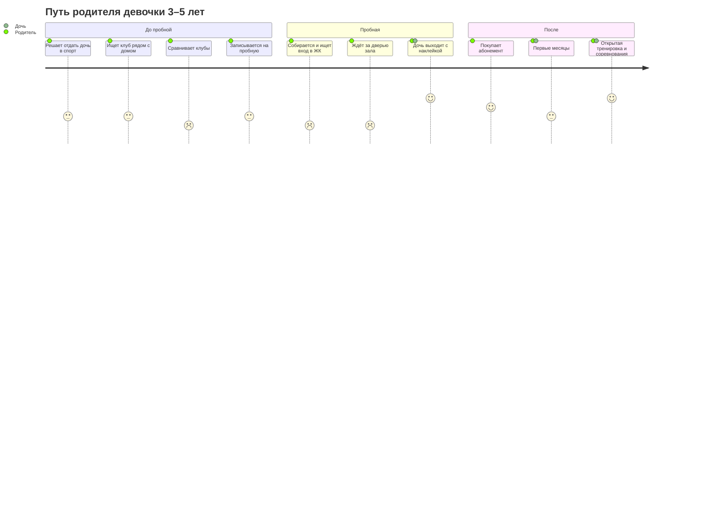

# CJM — путь клиента клуба «Фаворит»

Версия 1 от 26.10.2026. Собрана по стратегии и ответам клиентки ([README](../README.md)), интервью с родителями не было — поэтому это гипотезы. Как проверить — в конце документа.

Что из этого следует для сайта — в [карте сайта](sitemap.md).

## Кто клиент

Платит и принимает решение родитель (чаще мама), занимается девочка. Но голос у ребёнка решающий: если на пробной не понравилось, второй раз не придут.

| Сегмент | Кто | Что важно | Группа |
|---|---|---|---|
| **А. Новички — основной поток** | Родитель девочки 3–6 лет из ЖК Riverside, «Ривер Парк», района Чёрной речки. Гимнастикой ребёнок раньше не занимался | Близко к дому, безопасно, «не ломают», ребёнку нравится, удобно вечером | Начальная подготовка |
| **Б. Уходят из «жёсткого» клуба** | Девочка 6–10 лет занималась в СШОР или строгой школе — слёзы, давление, травма, пропал интерес | Вернуть ребёнку интерес и не потерять уровень | Средняя или старшая |
| **В. Переросли секцию «для здоровья»** | Девочка занималась в кружке и хочет выступать | Разряды, соревнования, официальный статус | Средняя |

Основная CJM ниже — для сегмента А. Чем отличаются Б и В — в отдельной таблице.

## Кривая эмоций (сегмент А)

От 1 — плохо до 5 — отлично.

**Провалы:** сравнение клубов, дорога до зала, ожидание за дверью. Это главные места, где родителя можно потерять.
**Пики:** наклейка после пробной, открытая тренировка, соревнования. В эти моменты стоит просить отзыв и рекомендацию.

---

## Этапы

### 1. Решение «пора в спорт»

- **Что происходит:** дочке 3–4 года, родитель думает про первую секцию. Поводы: подружка из садика ходит на гимнастику, увидели выступление, ребёнок очень активный или гибкий, врач посоветовал заняться осанкой.
- **Вопросы:** «Не рано ли в 3 года?», «Гимнастика — это ведь тяжело и больно?», «Что выбрать — гимнастику, танцы, плавание?»
- **Где это происходит:** разговоры с другими мамами, чаты ЖК, садик, Монтессори-школа Михайловой (зал — в её здании), Instagram, VK.
- **Эмоции:** интерес и лёгкая тревога.
- **Барьер:** стереотип «художественная гимнастика — это слёзы, растяжка через боль и строгие тренеры».
- **Что делаем:**
  - *Сайт:* первый экран сразу снимает страх — с 3 лет, в игровой форме, без слёз и давления.
  - *Вне сайта:* быть там, где родители советуются: чаты ЖК, Монтессори-школа (объявление, открытое занятие), сарафанное радио («Приведи друга»).

### 2. Поиск вариантов

- **Что происходит:** ищет «художественная гимнастика рядом» в Яндекс Картах, спрашивает в чате ЖК, ищет в Яндексе.
- **Вопросы:** «Что есть рядом с домом?», «Сколько стоит?», «Во сколько занятия — успею после работы?»
- **Где:** Яндекс Карты и 2ГИС (рейтинг, отзывы, фото), поиск Яндекса, чат ЖК, сайт.
- **Эмоции:** деловой настрой, немного теряется от количества вариантов.
- **Барьеры:** клуба нет на картах или карточка пустая; на сайте нет цен; непонятно, где именно зал.
- **Что делаем:**
  - *Сайт:* цены и расписание видны без звонка. На телефоне адрес и «м. Чёрная речка» видны на первом экране.
  - *Вне сайта:* заполненные карточки в Яндекс Картах и 2ГИС — фото зала, цены, ссылка на сайт, отзывы. Бонус 500 ₽ за отзыв уже есть — отзывы просим оставлять на Картах.

### 3. Сравнение и выбор

- **Что происходит:** открыла 2–4 варианта и сравнивает. Обычно это сетевая секция «для здоровья» рядом, государственная спортшкола и «Фаворит».
- **Вопросы:** «Не будут ли кричать и заставлять?», «Ребёнок негибкий — возьмут?», «Кто тренер?», «Есть ли перспектива — разряды, соревнования?», «Почему дороже или дешевле других?»
- **Где:** сайты клубов, отзывы, Instagram и VK клубов, советы знакомых.
- **Эмоции:** сомнения и тревога за ребёнка — самый напряжённый момент до пробной.
- **Барьеры:** все сайты обещают одно и то же; не видно лица тренера; не видно зала.
- **Что делаем на сайте:**
  - сравнение подходов: спортшкола / секция «для здоровья» / «Фаворит»;
  - тренер с фото, регалиями и человеческими словами о своём подходе;
  - то, чего нет у секций «для здоровья»: аккредитация, разряды, вычет 13%;
  - отзывы родителей, фото и видео тренировок и выступлений;
  - FAQ: негибкий ребёнок, возраст, можно ли прийти посреди года.

### 4. Запись на пробную

- **Что происходит:** оставляет заявку или пишет в мессенджер.
- **Вопросы:** «Сейчас начнут продавать по телефону?», «Быстро ли ответят?»
- **Где:** форма на сайте, мессенджер, телефон.
- **Эмоции:** решимость и опасение навязчивых продаж.
- **Барьеры:** длинная форма, обязательный звонок, долгий ответ — родитель уходит к тому, кто ответил быстрее.
- **Что делаем:**
  - *Сайт:* короткая форма — имя, телефон, возраст ребёнка, удобный способ связи. Рядом кнопка мессенджера. После отправки — экран «Спасибо» с понятным следующим шагом: когда свяжутся и что будет дальше.
  - *Вне сайта:* ответ в течение 1–2 часов в рабочее время. Шаблон подтверждения: время пробной, адрес и ссылка на памятку (страница «Пробная тренировка»).

### 5. Подготовка к пробной

- **Что происходит:** накануне собирает ребёнка и планирует дорогу.
- **Вопросы:** «Что надеть?», «Что с волосами?», «Что взять с собой?», «Как пройти на территорию ЖК — там же закрыто?»
- **Где:** сообщение от тренера, страница «Пробная тренировка», карта.
- **Эмоции:** волнение. У ребёнка — предвкушение или стеснение.
- **Барьеры:** **закрытая территория ЖК** — вход по брелку, через вторую лестницу от метро, зал внутри Монтессори-школы, а не с улицы. Легко заблудиться и опоздать. Сменная обувь для родителей и бахилы — неожиданность, если не предупредить.
- **Что делаем:**
  - *Сайт:* страница «Пробная тренировка» — форма одежды, что взять и фото-маршрут от метро до гардероба.
  - *Вне сайта:* напоминание накануне со ссылкой на памятку; тренер встречает у входа (уже так и есть).

### 6. Пробная тренировка

- **Что происходит:** тренер встречает, ребёнок идёт в зал, родитель ждёт на диванчике у гардероба.
- **Вопросы:** «Почему мне нельзя посмотреть?», «Как она там, не плачет?»
- **Где:** тренер, здание, гардероб, сам ребёнок после занятия.
- **Эмоции:** у родителя — тревога, он не видит, что происходит. У ребёнка — восторг или стеснение. Пик — дочь выходит с наклейкой.
- **Барьер:** родителей не пускают в зал. Если узнали об этом только на месте — выглядит так, будто что-то скрывают.
- **Что делаем:**
  - *Сайт:* заранее объясняем, почему родители ждут снаружи (самостоятельность, внимание, дисциплина) — в FAQ и на странице пробной.
  - *Вне сайта:* после занятия тренер 2–3 минуты рассказывает, как ребёнок себя показал и какая группа подойдёт. Если можно — фото с занятия в мессенджер (с согласия родителя). Наклейка уже есть — это сильный момент.

### 7. Решение и покупка абонемента

- **Что происходит:** дома обсуждают, дочь просится ещё — покупают абонемент.
- **Вопросы:** «Какой абонемент выбрать?», «Как платить?», «Есть ли скидки?», «А если заболеет?»
- **Где:** тренер, сайт (цены и скидки), мессенджер.
- **Эмоции:** облегчение — выбор сделан.
- **Барьеры:** непонятно, как платить. Страх «заплатим, а она заболеет» — а правила перерасчёта строгие: от 2 пропусков, по справке, не чаще раза в квартал.
- **Что делаем:**
  - *Сайт:* цены, скидки (второй ребёнок, «Приведи друга», отзыв), способы оплаты, правила перерасчёта и налоговый вычет — всё открыто, без мелкого шрифта.
  - *Вне сайта:* после пробной тренер сразу называет подходящую группу и абонемент.

### 8. Первые месяцы

- **Что происходит:** регулярные тренировки, ребёнок привыкает, родители осваивают правила.
- **Вопросы:** «Есть ли прогресс?», «Где купить скакалку, обруч, мяч?», «Что делать, если опаздываем?»
- **Где:** тренер, родительский чат группы (уточнить, есть ли), страница «Родителям».
- **Эмоции:** сначала энтузиазм, потом может быть спад — тяжело, надоело.
- **Барьеры:** правила разбросаны по сообщениям; прогресс не виден; пропуски по болезни.
- **Что делаем:**
  - *Сайт:* страница «Родителям» — все правила в одном месте: когда приходить, внешний вид, предметы, перерасчёт, брелок, скидки.
  - *Вне сайта:* наклейки в блокноте — видимый прогресс. Открытая тренировка перед Новым годом — первый момент, когда родители видят результат.

### 9. Рост и рекомендации

- **Что происходит:** городские соревнования в конце года, переход в среднюю группу, первые разряды, сборы.
- **Мысли:** «Она правда может выступать!», «Посоветую подруге».
- **Где:** соревнования, родительский чат, VK, Яндекс Карты, разговоры с другими мамами.
- **Эмоции:** гордость — главный пик.
- **Барьер:** про бонусы за друга и отзыв никто не помнит.
- **Что делаем:**
  - *Сайт:* фото с медалями и разрядными книжками — заодно это доказательство для новых родителей на этапе 3.
  - *Вне сайта:* напоминать про «Приведи друга» и отзыв в пиковые моменты — после открытой тренировки и соревнований.

---

## Чем отличаются сегменты Б и В

| Этап | Б. Уходят из «жёсткого» клуба | В. Переросли секцию «для здоровья» |
|---|---|---|
| Повод | Ребёнок плачет перед тренировками, давление тренера, травма | Ребёнку мало кружка, хочет выступать |
| Что ищут | «Художественная гимнастика без давления», отзывы о тренерах | «Художественная гимнастика с разрядами», «аккредитованный клуб» |
| Главный страх | Повторится то же самое | Опять будет «для галочки», без результата |
| Что убеждает | Блок «Вернём любовь к гимнастике», подход тренера, отзывы таких же родителей | Аккредитация Федерации, разряды, соревнования и сборы, достижения учениц |
| Пробная | Мягко, без проверки «на прочность»; поговорить с родителем о прошлом опыте | Тренер оценивает уровень и сразу говорит про группу и перспективы |
| Группа | Средняя или старшая | Средняя |

## Выводы для сайта

1. **Сначала мобильная версия** — с Карт, из чатов и Instagram родители заходят с телефона.
2. **Первый экран** снимает главный страх («без слёз и давления») и сразу показывает возраст, адрес и кнопку записи.
3. **Цены и расписание открыты** — без «узнайте по телефону».
4. **Страница «Пробная тренировка»** с фото-маршрутом через закрытую территорию ЖК. Ссылку на неё тренер отправляет после записи.
5. **Заранее объясняем**, почему родители ждут за дверью.
6. **Короткая форма записи** и кнопка мессенджера.
7. **Страница «Родителям»** для тех, кто уже занимается.
8. **Аккредитация, разряды и вычет 13%** — отдельными заметными аргументами.

## Выводы вне сайта

1. Карточки в Яндекс Картах и 2ГИС: фото, цены, ссылка на сайт, отзывы.
2. Чаты ЖК Riverside и «Ривер Парк», Монтессори-школа — главные места, где советуются родители.
3. Быстрый ответ на заявку и шаблоны сообщений: подтверждение, напоминание накануне, сообщение после пробной.
4. Короткая обратная связь от тренера после пробной.
5. Просить отзыв и рекомендацию в пиковые моменты.

## Как проверить гипотезы

Спросить у клиентки:
- Откуда сейчас приходят ученики? Это подтвердит или поправит этапы 1–2.
- Сколько пришедших на пробную покупают абонемент? Почему остальные не возвращаются?
- Какие вопросы родители задают чаще всего до записи и в первый месяц?
- Есть ли родительские чаты групп?

И по возможности коротко поговорить с 3–5 родителями: как искали клуб, что сравнивали, что чуть не остановило.
