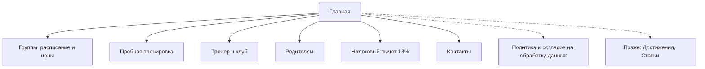

# Карта сайта и содержимое страниц

Версия 1 от 26.10.2026. Основа — структура из стратегии ([README, раздел 7](../README.md#7-структура-сайта-тз-из-стратегии)) и выводы [CJM](cjm.md). Тексты заголовков — черновики.

## Формат

**Главная — подробный лендинг**, который сам проводит родителя от первого знакомства до записи на пробную. Большинство придёт именно на неё: с Карт, из чатов ЖК, по рекомендации.

**Плюс шесть отдельных страниц.** Каждая отвечает на свой поисковый запрос в Яндексе. И на них удобно давать ссылку в мессенджере: «вот памятка к пробной», «вот правила для родителей».

| Страница | Адрес | Этап CJM | Главная задача | Когда |
|---|---|---|---|---|
| Главная | `/` | 1–4 | Убедить и записать на пробную | Запуск |
| Группы, расписание и цены | `/groups` | 2–3, 7 | Подобрать группу, показать цены | Запуск |
| Пробная тренировка | `/trial` | 4–6 | Подготовить к первому визиту и довести до зала | Запуск |
| Тренер и клуб | `/about` | 3 | Доверие к тренеру и официальному статусу | Запуск |
| Родителям | `/parents` | 7–8 | Все правила для тех, кто уже занимается | Запуск |
| Налоговый вычет 13% | `/tax-deduction` | 3, 7 | Аргумент «за» и инструкция | Запуск |
| Контакты | `/contacts` | все | Адрес, как пройти, связь | Запуск |
| Политика и согласие | `/privacy`, `/consent` | — | Требование закона для формы заявки | Запуск |
| Достижения | `/achievements` | 3, 9 | Медали, разряды, соревнования | Когда соберём фото |
| Статьи | `/blog` | 1–2 | Посетители из поиска | Позже |

## Общие элементы

- **Шапка:** логотип, меню (Группы и цены · Пробная · Тренер · Родителям · Контакты), телефон или мессенджер, кнопка «Записаться на пробную». На телефоне — логотип, кнопка записи и меню-бургер.
- **Плавающая кнопка на телефоне:** «Записаться» и мессенджер.
- **Форма записи** — одна на весь сайт: имя родителя, телефон, возраст ребёнка, как удобнее связаться. Галочка согласия на обработку данных не проставлена заранее и ведёт на `/consent`. После отправки — экран «Спасибо»: когда свяжемся и что будет дальше.
- **Подвал:** адрес и метро, телефон, VK, меню, «Аккредитация Федерации художественной гимнастики СПб», реквизиты (ИП или ООО, ИНН, ОГРН), ссылки на политику и согласие.

---

## 1. Главная — `/`

**Задача:** за 1–2 минуты снять страх, показать отличие от других клубов и привести к записи.
**Для поиска:** title «Художественная гимнастика для девочек от 3 лет у м. Чёрная речка — клуб «Фаворит»». Запросы: художественная гимнастика для детей СПб, художественная гимнастика Приморский район, художественная гимнастика Чёрная речка, художественная гимнастика с 3 лет. Частотность проверить в Вордстате.

| # | Блок | Содержимое |
|---|---|---|
| 1 | **Первый экран** | H1: «Художественная гимнастика для девочек от 3 лет». Подзаголовок: «От первых шагов до разрядов — без слёз и жёсткого давления. Ушаковская набережная, м. Чёрная речка». Четыре коротких аргумента: аккредитация Федерации ХГ СПб · налоговый вычет 13% · игровая форма и наклейки за старания · бережная адаптация. Кнопки: «Записаться на бесплатную пробную» и «Группы и цены». Фото: настоящая тренировка малышей с тренером, не сток |
| 2 | **Сравнение подходов** | Таблица «Спортшкола / Секция для здоровья / Фаворит» по строкам: разряды и аккредитация, отбор, отношение к ребёнку, нагрузка, соревнования. Без названий конкурентов и без негатива — закон о рекламе запрещает некорректное сравнение, да и стратегия советует признавать сильные стороны других |
| 3 | **Группы** | Три карточки: название, возраст, 2–3 строки о том, что делают, дни и время, цена «от», кнопка «Подробнее» → `/groups`. Под карточками: «Не знаете, какая группа подойдёт? Тренер подскажет на пробной» |
| 4 | **Тренер** | Фото Анастасии Андреевны Варламовой (Клюевой). Факты: мастер спорта России, НГУ им. Лесгафта, 14 лет в гимнастике, больше 10 лет тренирует, выступала на открытии и закрытии Кубка Конфедераций 2017. Цитата о подходе (нужна). Кнопка → `/about` |
| 5 | **«Вернём любовь к гимнастике»** | Обращение к родителям, чьи дочери ушли из «жёсткого» клуба: «Если перед тренировкой дочь плачет, а слово „гимнастика“ стало для неё синонимом крика — приходите познакомиться». Как мы работаем с такими детьми: мягкая адаптация, индивидуальный темп. Кнопка «Прийти на пробную» |
| 6 | **Как проходит пробная** | Четыре шага: заявка → подтверждение и памятка → тренер встречает у входа → рассказ тренера после занятия. «Бесплатно». Ссылка → `/trial` |
| 7 | **Жизнь клуба** | Фото-сетка: форма с эмблемой, хореография, соревнования, сборы и лагеря, открытая тренировка перед Новым годом, наклейки и блокнот. Состав уточнить: хореограф, питание, домашние задания — из стратегии |
| 8 | **Цены коротко** | Три строки «от 6 400 ₽», «от 6 800 ₽», «от 9 000 ₽». Скидки: 20% на второго ребёнка, 500 ₽ за друга, 500 ₽ за отзыв. Плашка «Вернём 13% через налоговый вычет». Ссылки → `/groups`, `/tax-deduction` |
| 9 | **Отзывы и достижения** | 4–6 отзывов родителей (с Яндекс Карт или напрямую, с согласия). Фото с медалями и разрядными книжками. Ссылка «Все отзывы на Яндекс Картах» |
| 10 | **Вопросы и ответы** | Раскрывающийся список, только вопросы до записи: с какого возраста? если ребёнок негибкий? можно ли прийти посреди года? можно ли родителям на занятие? что взять на пробную? есть ли соревнования? что, если ребёнок заболеет? как получить вычет? Ответы короткие — из README, раздел 8, со ссылками на `/trial`, `/parents`, `/tax-deduction` |
| 11 | **Как нас найти** | Карта. Адрес, метро «Чёрная речка», сколько минут пешком (уточнить). Одной фразой — про вход через территорию ЖК. Ссылка «Маршрут с фото» → `/trial#route` |
| 12 | **Финальная форма** | «Запишитесь на бесплатную пробную тренировку» + форма + кнопка мессенджера |

**Что изменили по сравнению со стратегией и почему.** Добавили блоки 6, 8 и 11: по CJM цена и дорога через закрытый ЖК — главные вопросы до записи. Отзывы и FAQ разделили на два блока. Порядок остальных блоков — как в стратегии.

---

## 2. Группы, расписание и цены — `/groups`

**Задача:** родитель понимает, в какую группу отдать ребёнка, когда занятия и сколько стоит.
**Для поиска:** «Группы, расписание и цены — художественная гимнастика „Фаворит“, СПб». Запросы: художественная гимнастика для детей 3, 4, 5 лет цена; художественная гимнастика с разрядами.

1. **Подводка:** три группы по возрасту и опыту, точнее группу подскажет тренер на бесплатной пробной.
2. **Начальная подготовка** — 3–6 лет, без подготовки. Что развиваем: ОФП, растяжка, сила, координация, осанка, скакалка и обруч. Как проходит: игра, наклейки за старания. Пн и ср 18:00–18:45. 6 400 ₽. Что будет за первый год: открытая тренировка перед Новым годом, по желанию — городские соревнования в конце года.
3. **Средняя группа** — от года занятий. Хореография, скакалка, обруч и мяч, свои программы, турниры, городские сборы и лагеря с 6,5 лет. 18:45–19:45, 20:15 или 20:45 (дни уточнить). 1 час — 6 800 ₽, 1,5 часа — 7 600 ₽, 2 часа — 8 000 ₽.
4. **Старшая группа** — с разрядами. Техника, булавы и лента, спортивные разряды, выездные сборы и соревнования высокого уровня. Пн и ср 18:00–20:45, вт и чт 18:30–20:30 (показывать ли школу № 113 — уточнить). 3 раза в неделю — 9 000 ₽, 4 раза — 10 000 ₽.
5. **Общее расписание** — таблица: дни недели × группы.
6. **Цены** — таблица абонементов, разовая тренировка 1 200 ₽, пробная бесплатно. За какой срок абонемент — уточнить.
7. **Скидки** — три карточки с условиями: второй ребёнок, «Приведи друга», отзыв.
8. **Оплата и перерасчёт** — способы оплаты (уточнить), коротко правила перерасчёта, подробно → `/parents`.
9. **Плашка про налоговый вычет** → `/tax-deduction`.
10. **Форма записи.**

---

## 3. Пробная тренировка — `/trial`

**Задача:** довести родителя от заявки до зала без потерь и лишней тревоги. Ссылку на эту страницу тренер отправляет в сообщении-подтверждении.
**Для поиска:** «Бесплатная пробная тренировка по художественной гимнастике у м. Чёрная речка».

1. **«Первая тренировка — бесплатно».** Кому подходит: девочкам от 3 лет, с подготовкой и без. Сколько длится.
2. **Как проходит** — по шагам: встреча у входа → переодевание → занятие (что делают на первой тренировке — нужен ответ клиентки) → наклейка и рассказ тренера → выбор группы.
3. **Что надеть и взять** — чек-лист: тёмные шорты или лосины; футболка, майка или купальник нейтрального цвета; белые носочки; волосы в хвост, длинные — в косичку и пучок; сменная обувь ребёнку и родителю; блокнот для наклеек; бахилы (есть ли на входе — уточнить). Одежда — спортивная форма, не домашний костюм.
4. **Маршрут с фото** (`#route`): метро «Чёрная речка» → вторая лестница по ходу от метро → вход на территорию ЖК Riverside (на пробную тренер встретит) → двухэтажное здание Монтессори-школы → 2 этаж, гардероб → зал. Каждый шаг — фото. Нужно снять.
5. **Где ждут родители и почему.** Диванчик у гардероба. В зал родителей не пускаем: ребёнку важно научиться заниматься самостоятельно и слушать тренера. Как узнать, как прошло: тренер расскажет после занятия.
6. **Приходите вовремя:** за 10 минут, не раньше; до тренировки — туалет и вода; если опаздываете — предупредите тренера.
7. **Что дальше:** выбор группы, абонемент, скидки, брелок для прохода на территорию.
8. **Форма записи** — для тех, кто пришёл на страницу из поиска.

---

## 4. Тренер и клуб — `/about`

**Задача:** доверие к человеку и к официальному статусу клуба.
**Для поиска:** «Анастасия Варламова — тренер по художественной гимнастике, клуб „Фаворит“».

1. **Анастасия Андреевна Варламова (Клюева).** Большое фото, регалии, путь в гимнастике, почему открыла клуб, подход и цитата (нужна).
2. **История клуба:** с 2019 года. Цели: любовь к гимнастике, спортивный характер, разряды — без психологических и физических травм.
3. **Официальный статус:** аккредитация Федерации художественной гимнастики СПб (скан или номер документа), право присваивать разряды, клуб в перечне для налогового вычета.
4. **Команда:** хореограф и другие тренеры — уточнить, кто есть.
5. **Как мы тренируем:** работа с мотивацией и нагрузкой. Развёрнутая версия блока «Вернём любовь к гимнастике».
6. **Достижения учениц:** разряды, медали, соревнования. Пока на этой странице, позже — отдельной.
7. **Форма записи.**

---

## 5. Родителям — `/parents`

**Задача:** все правила для тех, кто уже занимается, в одном месте. Меньше одинаковых вопросов тренеру в мессенджере.

1. **Перед тренировкой:** приходить за 10 минут, не раньше; предупреждать об опоздании; туалет и вода до занятия.
2. **Внешний вид:** полный список из README.
3. **Предметы:** скакалка, наколенники, обруч, мяч. Если нет — выдаст тренер. Где купить — подскажет тренер.
4. **Вход в здание:** брелок для прохода на территорию, бахилы, гардероб на 2 этаже, родители ждут у гардероба.
5. **Оплата и перерасчёт:** правила полностью.
6. **Скидки и как их получить:** второй ребёнок, «Приведи друга», отзыв (где оставить).
7. **Календарь сезона:** открытая тренировка перед Новым годом, городские соревнования в конце года, сборы. Даты уточнить.
8. **Налоговый вычет** → `/tax-deduction`.
9. **Связь с тренером.**

---

## 6. Налоговый вычет 13% — `/tax-deduction`

**Задача:** весомый аргумент на этапе выбора и понятная инструкция для тех, кто уже платит.
**Для поиска:** «Налоговый вычет за художественную гимнастику ребёнка». Запросы: налоговый вычет за спортивную секцию ребёнка, вычет за спорт.

1. **Коротко:** клуб в перечне физкультурно-спортивных организаций, поэтому родители могут вернуть 13% стоимости занятий.
2. **Кто может получить и сколько.** Лимиты и условия сверить с актуальными правилами ФНС перед публикацией.
3. **Пример:** абонемент 6 400 ₽ × 9 месяцев = 57 600 ₽, вернуть можно до 7 488 ₽. Если абонемент помесячный — уточнить.
4. **Какие документы нужны** и как запросить справку об оплате у клуба. Что выдаёт клуб — уточнить.
5. **Как подать:** через работодателя или через личный кабинет налогоплательщика.

---

## 7. Контакты — `/contacts`

1. **Адрес:** Ушаковская наб., 3 к. 4, ЖК Riverside, Монтессори-школа Михайловой, 2 этаж. Метро «Чёрная речка».
2. **Яндекс Карта.**
3. **Как пройти:** коротко + ссылка на фото-маршрут → `/trial#route`.
4. **На машине:** парковка и подъезд (уточнить).
5. **Другие залы:** Караваевская ул. и школа № 113 — если решим показывать.
6. **Телефон, мессенджеры, VK.**
7. **Реквизиты:** ИП или ООО, ИНН, ОГРН.

---

## 8. Политика и согласие — `/privacy`, `/consent`

- **Политика обработки персональных данных** обязательна, раз на сайте есть форма заявки (152-ФЗ).
- **Согласие на обработку персональных данных** — с 1 сентября 2025 года оформляется отдельным документом. Галочка в форме не проставлена заранее.
- **Уведомление о cookie**, если ставим Яндекс Метрику.
- Проверить, подано ли уведомление в Роскомнадзор об обработке персональных данных.

---

## Позже

- **Достижения** — когда соберём фото медалей и разрядных книжек.
- **Статьи** — для посетителей из поиска: «С какого возраста отдавать в художественную гимнастику», «Как выбрать секцию», «Что такое спортивные разряды».
- **Отдельные страницы групп** — если Вордстат покажет спрос на запросы по возрасту.

## Что собрать для страниц

**Фото**
- [ ] Тренер — портрет и на тренировке
- [ ] Зал и тренировки каждой группы
- [ ] Маршрут от метро до гардероба — каждый шаг
- [ ] Форма с эмблемой
- [ ] Медали, разрядные книжки, соревнования
- [ ] Согласия родителей на публикацию фото детей

**Тексты и факты**
- [ ] Цитата тренера о подходе
- [ ] Ответы: «Что, если ребёнок негибкий?», «Как проходит первая тренировка?»
- [ ] 4–6 отзывов
- [ ] Команда: хореограф, другие тренеры
- [ ] Дни средней группы, за какой срок абонемент, способы оплаты
- [ ] Календарь сезона
- [ ] Сколько идти от метро, парковка, есть ли бахилы на входе

**Документы**
- [ ] Аккредитация Федерации ХГ СПб
- [ ] Реквизиты клуба
- [ ] Что клуб выдаёт для налогового вычета
- [ ] Политика и согласие на обработку персональных данных
